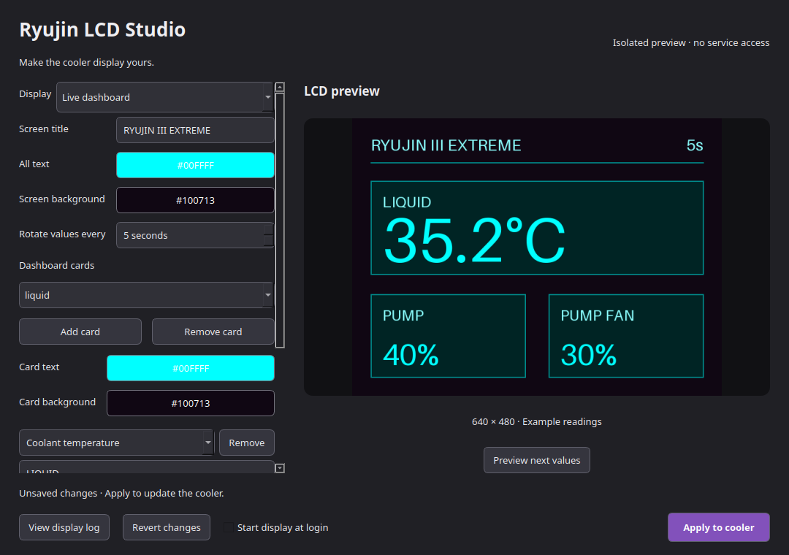

# Ryujin LCD Studio

A native PyQt5 editor for the ASUS Ryujin III Extreme LCD dashboard. It uses
the renderer from the installed experimental `liquidctl` driver, so the preview
matches the real 640 × 480 display. Preview readings are examples. Existing
custom statistic command arrays are kept in the profile, but the editor never
runs them in the preview.



Unofficial Linux software for **ASUS ROG Ryujin III Extreme**, tested with USB
ID `0b05:1bcb` and firmware `AURJ3-S5F9-0104`. Other Ryujin models are not verified.
The screenshot is an editor preview with sample values, not a photo of the LCD.

## Install

Requires Linux with a graphical desktop, Python **3.10+**, git and Python venv
support. On Debian/Ubuntu, install `python3-venv`, `git`, `libusb-1.0-0`,
`libhidapi-hidraw0` and Qt's system libraries if absent. No system Python packages
are overwritten.

Download and extract the release, keep the source directory in a permanent
location, then run:

```sh
cd ryujin-lcd-studio-1.0.0
./setup.sh
~/.local/bin/ryujin-lcd-studio
```

Setup creates `~/.local/share/ryujin-lcd-studio/venv`, installs dependencies and
adds the launcher/application menu entry. It preserves an existing environment
and `ryujin-lcd` command, checking the imports instead of upgrading them. The
launcher-only `./install.sh` remains available when the environment already
exists. Existing launchers/menu entries receive timestamped backups. Neither
script touches the display service, profiles, USB device, pump or fans.

The app relies on private rendering/schema APIs from the experimental liquidctl
Ryujin LCD driver. `requirements.txt` pins the exact tested upstream commit:
[8725018](https://github.com/Aenima4six2/liquidctl/tree/87250180944d2626d25fc37cf4a6240068f44e18),
from [liquidctl PR #914](https://github.com/liquidctl/liquidctl/pull/914).
A stock liquidctl release may not provide this driver/API. The upstream driver
is installed as a dependency; it is not vendored or claimed as original Studio
code. Keep its upstream attribution and license when redistributing it.

## USB access and first use

The editor preview does not need USB access. To use **Apply to cooler**, configure
normal-user access to the tested USB device. An example rule is included:

```sh
sudo install -m 644 udev/70-ryujin-lcd.rules /etc/udev/rules.d/70-ryujin-lcd.rules
sudo udevadm control --reload-rules
sudo udevadm trigger --subsystem-match=hidraw
sudo udevadm trigger --subsystem-match=usb
```

Review and back up an existing rule before replacing it. The rule is scoped to
`0b05:1bcb`; it does not grant access to every USB device. Rules may require a
new local login or device re-enumeration before permissions take effect. Do not
unplug a CPU cooler while the machine is running simply to refresh permissions.

One process must own the cooler. Stop any existing cooler-monitoring/LCD process
before transferring ownership to this app. The editor's Apply path manages its
own `ryujin-lcd.service` and starts it only when you explicitly Apply. Stop that
service before using another liquidctl/cooler USB command, then start it again
afterwards. Closing the editor leaves the display service running. Keep the
source directory and venv paths stable because the generated unit and custom
sensor commands reference them.

## Features

The editor can change the overall screen title, rotation interval, global
text/background colors, and up to four cards. Each card has text/background
colors, editable labels, and one or more rotating built-in readings. Static
image and animated GIF modes include a media preview and validation. No pump or
fan duty controls are provided.

## Host sensor readings

The searchable per-reading selector groups the built-in cooler readings, CPU,
memory/swap, GPUs, SSD/DIMM, and other motherboard sensors. Options show their
units; RAM free, available, and used have distinct names. The row below each
selection reports its latest live value, or says when it is unavailable or
stale. **Refresh sensors** rediscovers hardware without changing the profile.
A sensor that disappears stays selected as unavailable and can return on a
later refresh.

Selected host readings are saved as the driver's supported custom statistic
using this application's Python environment and `sensors.py --read SENSOR_ID`.
In a normal editor window, **Live host readings in preview** is enabled by
default and samples only recognized selected sensor IDs about every two
seconds. It reads `/proc`, `/sys`, and `nvidia-smi`; it never writes hardware
controls, accesses the cooler's USB device, or executes saved custom commands.
NVIDIA sampling is bounded to 0.8 seconds and CPU load sampling to 0.1 seconds.
Cooler readings remain clearly marked as examples. Isolated `--config-dir`
previews start with live reads off.

## Editing and applying

Apply is enabled only while editor changes are pending. **Revert changes**
confirms before reloading the saved profile; Ctrl+S applies pending changes.
Live sensor refreshes update the preview only and do not dirty the profile or
restart the display service.

## Apply and service ownership

Apply validates the dashboard with the same schema validator used by the
driver, validates selected image/GIF files, then atomically saves
`dashboard.json` and `display.json` under `~/.config/ryujin-lcd`. Existing
profile files and the prior user unit are copied to a timestamped directory in
`~/.config/ryujin-lcd/backups/` before changes. If file writing or service
startup fails, prior files are restored and the prior active service is
restarted when possible.

The user service owns the display process after Apply, so closing the editor
does not stop the LCD. Static mode exits after writing the image and uses
`RemainAfterExit=yes`; stats and GIF modes stay attached to the service. The
login checkbox explicitly enables or disables the user unit. It does not
change login startup until selected.

## Isolated preview and checks

`~/.local/bin/ryujin-lcd-studio --config-dir /tmp/ryujin-lcd-profile` opens an isolated profile
directory. This mode never calls systemd and Apply performs validation only;
it does not write files. It is suitable for visual review and smoke checks.

Tests use temporary directories and a fake systemd runner:

```sh
~/.local/share/ryujin-lcd-studio/venv/bin/python -m unittest discover -s tests
QT_QPA_PLATFORM=offscreen ~/.local/share/ryujin-lcd-studio/venv/bin/python app.py \
  --config-dir /tmp/ryujin-lcd-studio-smoke --smoke-test \
  --screenshot /tmp/ryujin-lcd-studio-preview.png
```

The display stays at the driver's existing behavior until Apply is used.


## License and validation

GPL-3.0; see [LICENSE](LICENSE). PyQt5, Pillow and liquidctl retain their own
licenses. This is an independent project, not an ASUS or liquidctl-endorsed app.
[Validation and known limits](docs/validation.md) distinguish live LCD testing
from editor-only tests. No pump/fan duty, brightness or orientation controls are
provided. Host sensor availability depends on your Linux drivers; GPU readings
use nvidia-smi where available.

Release packages include source, examples, tests and the scoped USB-rule example.
Build one with `python3 scripts/package.py`; checksums are in `dist/SHA256SUMS`.
CI runs tests and isolated offscreen preview without cooler access.
